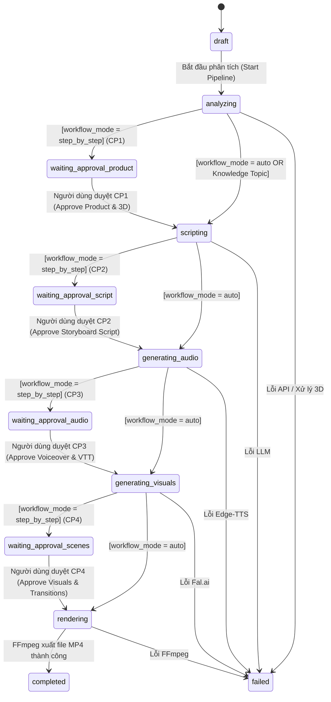

# Step-by-Step & Full-Auto State Machine Skill

Skill này định nghĩa luồng chuyển tiếp trạng thái (`ProjectStatus`) của một dự án video (`VideoProject`) và cách điều phối Laravel Queue Jobs trên PM2.

---

## 1. Sơ Đồ Trạng Thái Dự Án (`ProjectStatus`)

Dự án đi qua 11 trạng thái chuẩn (kèm trạng thái `failed` khi xảy ra lỗi không thể phục hồi):

---

## 2. Chi Tiết 4 Cổng Kiểm Duyệt (Checkpoints 1 -> 4)

| Cổng duyệt | Trạng thái (`ProjectStatus`) | Nội dung kiểm duyệt & Chỉnh sửa | Queue phụ trách bước kế tiếp |
| :--- | :--- | :--- | :--- |
| **CP1** | `waiting_approval_product` | Kiểm tra ảnh đã tách nền (`rembg`), mô hình 3D `.glb` đã chuẩn hóa kích thước (`trimesh`), và chân dung khách hàng mục tiêu từ Gemini Vision. | `ai-orchestration` |
| **CP2** | `waiting_approval_script` | Kiểm tra và sửa trực tiếp kịch bản phân cảnh (`storyboard_scenes`): lời thoại tiếng Việt, `visual_prompt`, `sfx_prompt`, và `Master Style Prompt`. | `ai-orchestration` |
| **CP3** | `waiting_approval_audio` | Nghe thử từng file giọng đọc `.mp3` (`vi-VN-HoaiMyNeural` / `vi-VN-NamMinhNeural`), kiểm tra thời lượng mili-giây (`duration_ms`) và phụ đề `.vtt`. | `ai-orchestration` |
| **CP4** | `waiting_approval_scenes` | Xem trước ảnh keyframe (`flux/schnell`) hoặc video clip (`ltx-video`), chọn lại hiệu ứng chuyển cảnh (`transition_type`) trước khi render FFmpeg. | `ffmpeg-render` |

---

## 3. Quy Tắc Tự Động Bỏ Qua Cổng Duyệt (`workflow_mode = 'auto'`)

1. **Chế độ Mặc định (`WorkflowMode::STEP_BY_STEP`)**:
   - Khi một Worker hoàn thành một pha (ví dụ: `scripting`), dự án chuyển sang trạng thái cổng duyệt tương ứng (`waiting_approval_script`) và **dừng lại**, chờ người dùng bấm nút **"Duyệt & Tiếp tục"** (hoặc chỉnh sửa nội dung rồi duyệt).
2. **Chế độ Tự động hoàn toàn (`WorkflowMode::AUTO`)**:
   - Khi người dùng bật công tắc `workflow_mode = 'auto'` (ngay từ đầu hoặc bất kỳ lúc nào trong quá trình chạy), hàm điều phối chuyển trạng thái `advanceToNextStage()` sẽ tự động:
     - Bỏ qua trạng thái `waiting_approval_*` kế tiếp.
     - Chuyển thẳng sang trạng thái xử lý tiếp theo (`scripting`, `generating_audio`, `generating_visuals`, `rendering`).
     - Dispatch ngay Job tương ứng vào đúng Queue của PM2 (`ai-orchestration`, `3d-processing`, hoặc `ffmpeg-render`).
3. **Bật `AUTO` khi đang đứng ở Cổng duyệt**:
   - Nếu dự án đang dừng ở `waiting_approval_script` (CP2) và người dùng gạt công tắc sang `AUTO`, hệ thống lập tức kích hoạt bước kế tiếp (`generating_audio`) và chạy một mạch tới `completed`.
